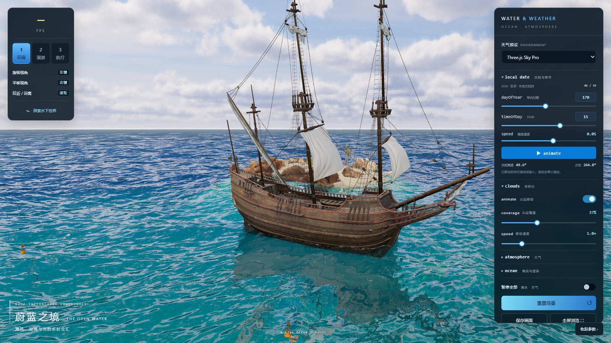

# 蔚蓝之境 · Ocean Scene



从「海洋 + 体积云」示例工程中独立抽出的**海洋场景**，Vue 3 + TypeScript + Vite + Three.js 单页项目。
原工程中的「功能实验室（ThreeJs.vue）」与「数字乡村（digitalMap）」未包含在本项目内。

## 技术栈

| 依赖 | 说明 |
| --- | --- |
| vue ^3.5 | 单页视图与参数面板 |
| three ^0.177 | 渲染核心，Reflector / GLTF / Draco |
| @takram/three-atmosphere 0.19.1 | 预计算大气散射 LUT、太阳 / 月亮方向 |
| @takram/three-clouds 0.7.6 | 体积云渲染 |
| @takram/three-geospatial 0.9.1 | 椭球坐标、STBN 噪声加载 |
| postprocessing 6.39.5 | EffectPass 后处理链 |

## 启动

```bash
npm install
npm run dev        # http://localhost:3004
npm run build      # 产物在 dist/
npm run preview    # 预览构建产物
```

## 目录

```
src/
  App.vue                     页面外壳（全屏承载海洋场景）
  main.ts                     入口
  assets/main.css             全局重置样式
  components/water/
    WaterScene.vue            场景容器：加载遮罩、视角面板、天气参数面板、标题
    water-scene.css           面板与 UI 样式
    OceanScene.ts             引擎主类：渲染器、相机、海面、船、岛屿、海底、输入
    SpectralOcean.ts          三层 JONSWAP 波谱 + GPU 二维逆 FFT（波高 / 位移）
    spectrum.ts               波谱采样与级联波长
    shaders.ts                海面 vertex / fragment（反射、折射、深度、白沫）
    foam.ts                   白沫覆盖贴图生成
    VolumetricSky.ts          大气 + 体积云 + 波峰环境反射
    UnderwaterLighting.ts     水下光照与雾效
    weather.ts                太阳 / 月亮星历、季节与时刻换算
    settings.ts               参数模型、天气预设、画质档位
public/
  water/models/*.glb          帆船、岛屿、浮标、礁石、海藻、海草、鱼群
  water/textures/*            白沫、沙地、法线、天光贴图
  water/takram/*              大气 LUT（exr）、体积云 shape / turbulence、STBN
  jsm/draco/gltf/*            Draco 解码器（模型压缩解码）
```

## 操作

| 操作 | 方法 |
| --- | --- |
| 环绕 / 漫游 / 航行 | 左上按钮，或数字键 `1` / `2` / `3` |
| 环绕视角 | 左键旋转、右键平移、滚轮缩放 |
| 漫游 | `WASD` / 方向键移动，`Q` 下潜、`E` 上浮，`Shift` 加速，左键转向 |
| 航行 | `W`/`S` 前进后退，`A`/`D` 转向；船体随浪浮动 |
| 水下观察 | 左下「探索水下世界」按钮 |
| 暂停全部 | 空格 或 右侧参数面板底部开关 |
| 显示 / 隐藏参数面板 | `H` |
| 重置 / 截图 / 全屏 | 参数面板底部 |

天气控制、复刻范围等细节见 `docs/water-scene.md`。

## 资源说明

模型与贴图遵循各自许可，来源见 `public/water/ATTRIBUTION.md`、`public/water/takram/LICENSE`。
